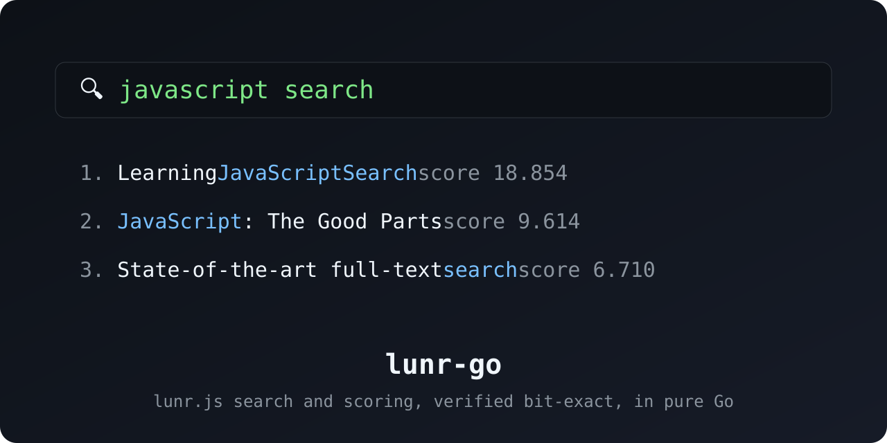

<div align="center">
  
  <h1>lunr-go</h1>
  <p><strong>lunr.js for Go: the client-side search engine your JS frontend already ships, verified score-for-score against the original.</strong></p>

</div>

Your docs site or app already searches in the browser with [lunr.js](https://lunrjs.com) - indexes built in the browser or at deploy time in Node are everywhere. Now the same search has to run in your Go backend: an admin panel, an API, a server-rendered page. A rewrite that ranks differently gives users different answers depending on where they typed, and the only other usual option is a heavyweight search server. lunr-go is a line-by-line port of the lunr.js 2.3.9 engine (about 9.3M npm downloads/week as of November 2026), verified against the pinned npm package on a differential corpus: same results, same scores, same ordering, same serialized index bytes, on every case that corpus tests (see [Verified against the original](#verified-against-the-original-not-just-inspired-by-it) for exactly what that covers, and [Known boundaries](#known-boundaries-by-design) for what it does not).

```bash
go get github.com/ofershap/lunr-go
```

```go
package main

import (
	"fmt"

	lunr "github.com/ofershap/lunr-go"
)

func main() {
	idx, err := lunr.New(func(b *lunr.Builder) {
		b.Ref("id")
		_ = b.Field("title", lunr.FieldAttributes{Boost: 10})
		_ = b.Field("body", lunr.FieldAttributes{})
		b.MetadataWhitelist = []string{"position"}
		b.Add(map[string]any{"id": "1", "title": "Learning JavaScript Search", "body": "Client-side search with lunr.js."}, 0)
		b.Add(map[string]any{"id": "2", "title": "The Go Programming Language", "body": "Types, methods, interfaces, goroutines."}, 0)
	})
	if err != nil {
		panic(err)
	}

	results, err := idx.Search("search")
	if err != nil {
		panic(err)
	}
	for _, r := range results {
		fmt.Printf("%s (score %.3f)\n", r.Ref, r.Score)
	}
}
```

Zero dependencies; module floor is Go 1.22.

## What you get

The full lunr.js 2.3.9 engine surface, with parity verified on the corpus described below:

- **The complete indexing pipeline** - tokenizer (JS `\s` + `-` separators, UTF-16 code-unit positions), trimmer, the built-in English stop-word list, and an exact port of lunr's Porter stemmer (including its initial-`y` handling and doubled-consonant rules).
- **lunr scoring** - BM25-style field-weighted scoring with `b` and `k1` tunables, field boosts, document boosts, and lunr's 3-decimal score rounding, computed through a bit-exact port of the fdlibm `log` routine V8 executes.
- **The full query language** - multi-term queries, `field:` scoping, `^boost`, `~edit-distance` fuzzy matching, leading/trailing/embedded `*` wildcards, `+required` and `-prohibited` presence, and `\` escaping - including lunr's exact `QueryParseError` messages.
- **Programmatic queries** - `idx.Query(func(q *lunr.Query) { q.Term(...) })` with per-clause fields, boost, edit distance, wildcard and presence options.
- **Index serialization and interchange** - `idx.Serialize()` emits byte-identical JSON to `JSON.stringify(lunrIndex)`; `lunr.LoadIndex` consumes an index serialized by lunr.js (and vice versa). Prebuild an index in Node at deploy time, or in Go, and query it from either side.
- **Pipeline customization** - `Pipeline.Add`/`Before`/`After`/`Remove`, registered functions (serialization-safe), and `Builder.Use` plugins, mirroring lunr's extension points.
- **Metadata whitelist** - token `position` (UTF-16 code-unit offsets, exactly as lunr reports) available on match data for highlighting.

## Verified against the original, not just inspired by it

Every merged change runs a differential suite (`go test ./...`) against fixtures generated by the pinned npm package (`lunr@2.3.9`, committed lockfile, `testdata/gen/`):

- **Byte-identical index serialization (on the tested indexes).** An index built by this package over the test corpus serializes to exactly the bytes `JSON.stringify(lunrIndex)` produces in Node, and a lunr.js-serialized index over the same corpus loads via `lunr.LoadIndex` and re-serializes byte-identically. Verified both directions on the committed corpus; like every claim here, scoped to what the corpus exercises.
- **Query parity on 40 queries** covering fields, boosts, edit distance, wildcards, presence operators, escapes, Unicode, emoji, stop words and misses: identical result refs, identical ordering, identical scores with exact `float64` bit equality - no tolerance. Error queries produce lunr's exact `QueryParseError` messages.
- **Query parser parity on 250 seeded random query strings**, compared clause-by-clause (term, fields, boost, edit distance, pipeline flag, presence).
- **Stemmer parity** on every distinct token of the corpus plus Porter edge cases (`byye`, `yls`, `triplicate`, ...), matched against `lunr.stemmer`.
- **Live JS consumption**: the Go-serialized index is loaded by `lunr.Index.load` in Node and re-run against all 40 queries (`node testdata/gen/gen.js` reports `GO->JS interchange: all queries match`).
- Unicode fidelity: JS `toLowerCase` semantics (not Go's - 56 runes differ, e.g. `İ`), JS `\s`/`\W` character classes, UTF-16 code-unit indexing throughout (a matched emoji costs 2 code units, exactly like lunr).
- Three fuzz targets (tokenizer, query parser, search) run in CI on every push. The module floor is verified on the real Go 1.22 toolchain.

This is what "verified" means here: exact equality against the pinned reference on the corpus above. It is strong evidence of fidelity, not a proof of universal equivalence for every possible input - that is why the corpus is committed and the generator is runnable (`cd testdata/gen && npm ci && node gen.js`).

### Known boundaries (by design)

- **English pipeline only.** lunr's core ships an English stemmer and stop-word list; this port matches that scope. The separate `lunr-languages` project (other languages' stemmers) is not ported, and `lunr.mutable` (updatable indexes) is out of scope - build a new index when documents change.
- **Pipeline functions are Go functions.** They serialize by their registered label (like lunr), but a custom Go pipeline function cannot be shared with a JS runtime the way data can.
- Documents are `map[string]any` with field values coerced the way lunr coerces them (strings, numbers, booleans, string arrays). Rich JS object coercion (`Date`, custom `toString`) is out of scope.
- This package ports lunr.js 2.3.9, the current release line. lunr's own API is stable and small; if lunr ships a new major version, that is new scope.
- **Fuzzy matching is bounded.** lunr.js accepts any `~N` on any term, and the fuzzy token set grows roughly with term-length^N: `~99999999` hangs (verified against Node 22), and even distance 4 on a 44-character term takes ~15 seconds on the 2,000-document bench corpus (measured). lunr's docs advise distances below 3. This port rejects fuzzy clauses above distance 3 or beyond a 32-character term with a clear `FuzzyLimitError` instead of hanging - an intentional divergence from lunr.js, and the only one. Everything inside the bounds matches lunr.js bit for bit (worst measured case inside the bounds: ~150ms).

## Performance

Single-run measurements (one run per workload: `-benchtime=1s` in Go, a timed loop in Node 22), 2,000 synthetic documents (title + body), same corpus, same machine (November 2026). No averaging across runs; treat as orientation, not a contract.

| Workload                    | lunr-go    | lunr.js 2.3.9 (Node 22) |
| --------------------------- | ---------- | ----------------------- |
| Index build (2,000 docs)    | 161 ms     | 95 ms                   |
| Search, hit ("search")      | 2.8 ms     | 3.1 ms                  |
| Search, miss ("zzzqqx")     | 0.011 ms   | 0.01 ms                 |
| Search, fuzzy ("search~1")  | 2.8 ms     | 2.7 ms                  |

Reproduce: `go test -bench . -run '^$'` and `node testdata/gen/bench_mirror.mjs`. Build speed favors Node (V8's JIT and lunr's tuning); query speed is at parity, which is what happens on the serving path. No claims beyond these workloads.

## Alternatives in the Go ecosystem

- **[bleve](https://github.com/blevesearch/bleve)** - a full-featured Go full-text search and indexing library. The right tool when you need analyzers in many languages, disk persistence, and facets; it does not read or write lunr indexes, and its scoring is its own, so a lunr.js frontend and a bleve backend rank differently.
- **lunr index generators** - repositories such as `hugo-golunr`, `lunr-indexer` and `go-lunr-generator` (found via GitHub topic search, November 2026) generate lunr-compatible index JSON from Go at build time; they are generators, not engines: querying still happens in JS. lunr-go runs the queries in Go and also reads/writes the index format.
- **Shipping the query to the client** - the classic answer; lunr-go exists for the cases where the data or the ranking must live behind a Go API.

As of November 2026, searches of pkg.go.dev and GitHub found no maintained Go port of the lunr query engine itself; that is an absence claim about those searches, not a proof none exists. If you maintain one, open an issue and we will link it.

<details>
<summary><strong>FAQ: lunr in Go, index interchange, and when to use what</strong></summary>

**Is there a Go version of lunr.js?**
Yes - lunr-go ports the lunr.js 2.3.9 engine to Go with zero dependencies. Results, scores, ordering, and the serialized index are verified bit-exact against the npm package on a differential corpus.

**Can I prebuild a lunr index in Node and query it from Go?**
Yes. Serialize with `JSON.stringify(idx)` in Node (lunr's `Index#toJSON` shape), then `lunr.LoadIndex(json)` in Go. Query results match lunr.js bit-for-bit on the tested corpus. The reverse direction works too: `idx.Serialize()` in Go loads with `lunr.Index.load` in JS.

**Does lunr-go rank the same as lunr.js?**
That is the point of the package. Scores are compared with exact `float64` bit equality on the differential corpus, including field boosts, document boosts, fuzzy and wildcard queries.

**Can my Go backend reuse the index my lunr.js frontend built?**
Yes - that is the interchange use case above. Note both sides must use the same pipeline: the default English pipeline (trimmer, stop words, stemmer) is what lunr-go ships and what lunr.js builds by default.

**lunr vs bleve in Go - which do I need?**
If your frontend already ships lunr.js, or you need to query `.json` lunr indexes, use lunr-go. If you need multilingual analysis, disk-resident indexes, or facets, use bleve.

**Does lunr-go support languages other than English?**
Not yet. lunr's core is English-only and so is this port; the `lunr-languages` stemmer collection is separate scope.

</details>

---

## Contributing

Issues and PRs welcome - see [CONTRIBUTING.md](CONTRIBUTING.md). Please report security issues privately per [SECURITY.md](SECURITY.md).

---

More projects: [gitshow](https://github.com/ofershap/gitshow) · [real-browser-mcp](https://github.com/ofershap/real-browser-mcp) · [cursor-usage-tracker](https://github.com/ofershap/cursor-usage-tracker) · [mcp-server-markdown](https://github.com/ofershap/mcp-server-markdown) · [readme-builder](https://github.com/ofershap/readme-builder) · [grok-bot-skills](https://github.com/ofershap/grok-bot-skills) · [mashov-parent-brief](https://github.com/ofershap/mashov-parent-brief) · [gailwind](https://github.com/ofershap/gailwind) · [lather](https://github.com/ofershap/lather)

---

## Author

[](https://gitshow.dev/ofershap)

[](https://linkedin.com/in/ofershap)
[](https://github.com/ofershap)
[](https://ofershap.github.io/)

---

<sub>README built with [README Builder](https://ofershap.github.io/readme-builder/)</sub>

## License

[MIT](LICENSE) &copy; [Ofer Shapira](https://github.com/ofershap), matching the lunr.js upstream license. See [NOTICE](NOTICE) for attribution to lunr.js and fdlibm.
